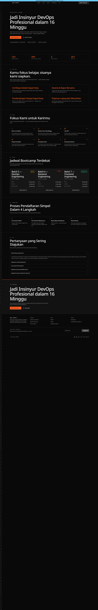
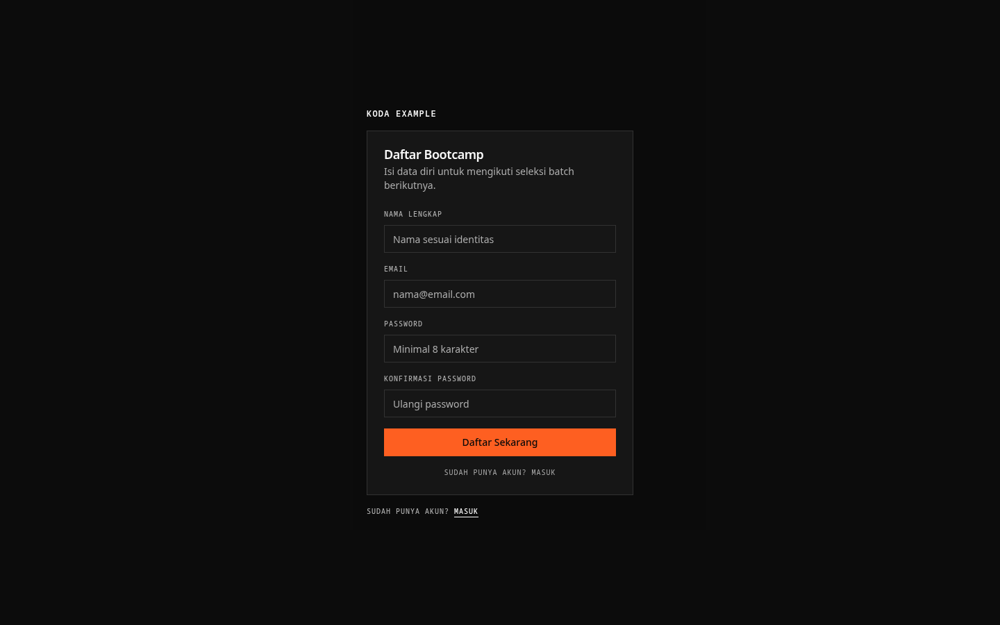
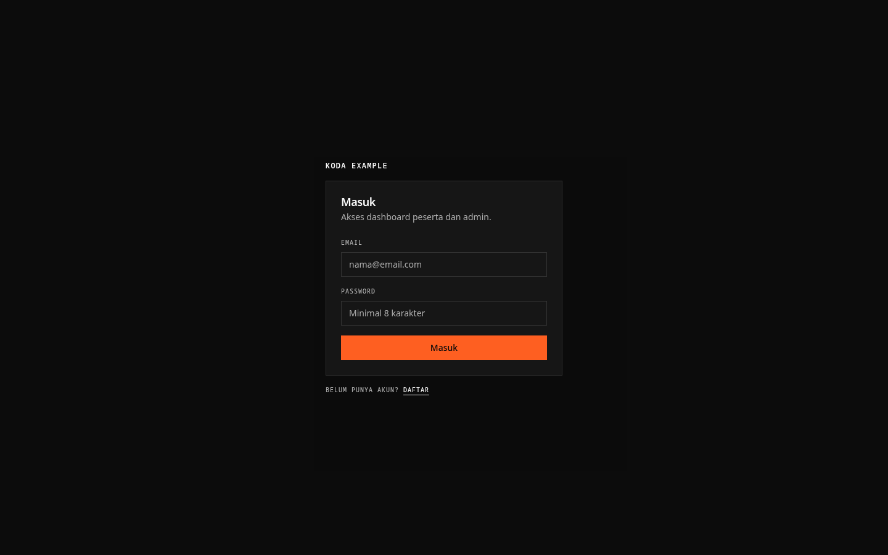
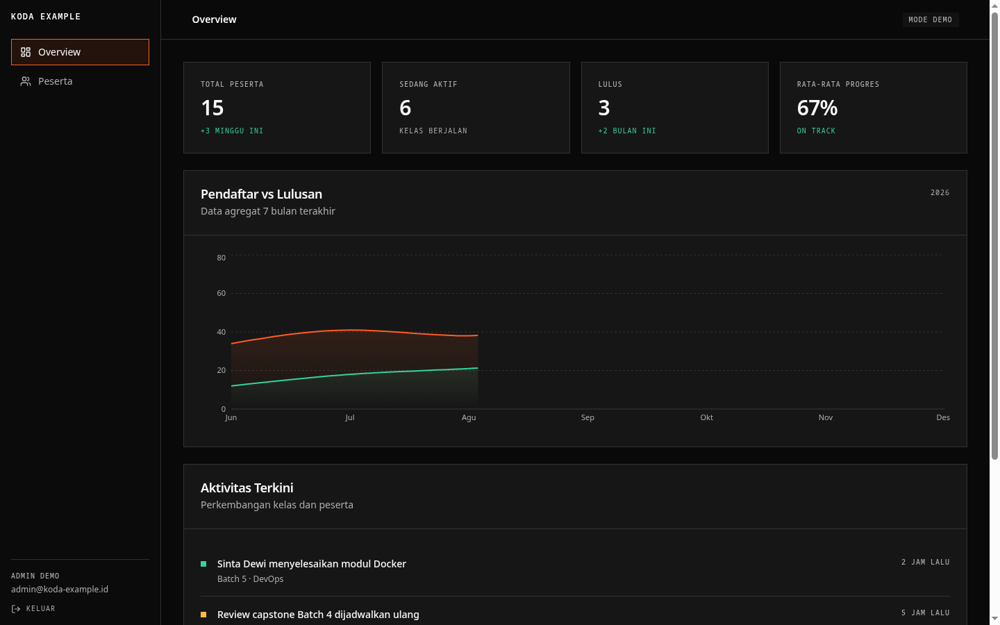
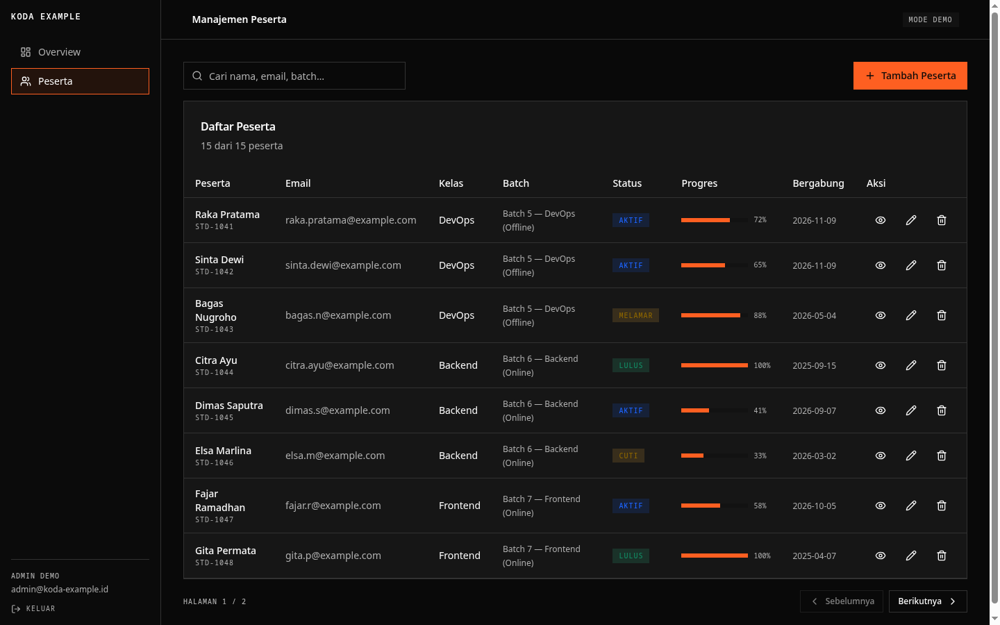
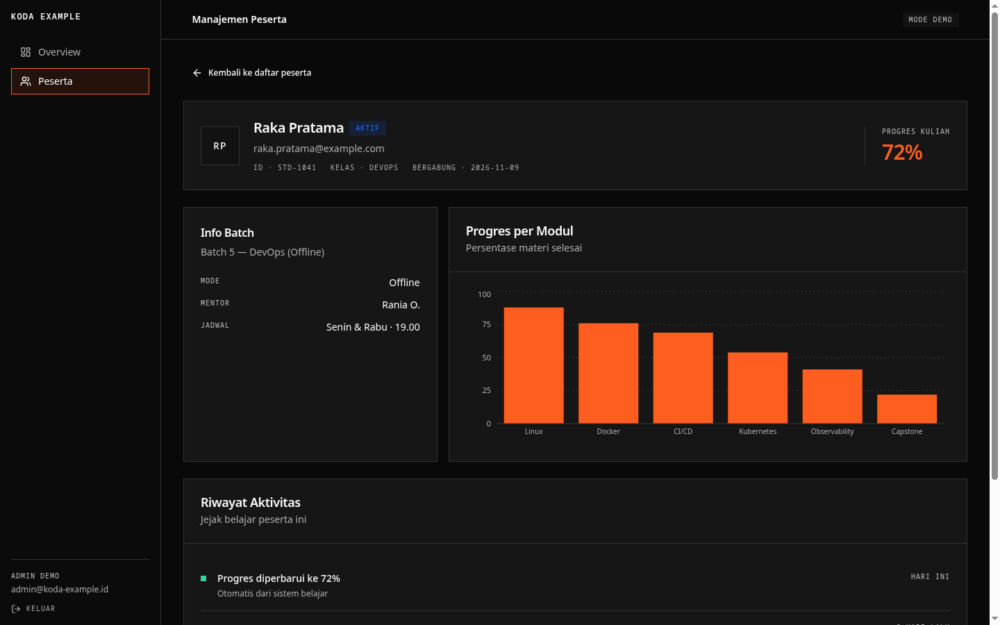

# koda-example

Consumer app for [koda-ui](../koda-ui): Vite + React 19 + react-router + Tailwind v4,
Indonesian marketing copy. Demonstrates every kit surface — landing, auth, dashboard —
plus a `/gallery` route rendering each component for capture.

## Run

```bash
npm install
npm run dev      # http://localhost:5173
npm run build    # dist/ — serve with any static server
npm run typecheck
```

## Routes

| Route | What |
| --- | --- |
| `/` | Landing: announcement bar, rule rail, hero, stats, fasilitas, fokus, jadwal batch, 4 langkah, FAQ, CTA, footer |
| `/gallery` | Every component, `data-capture` sections, dark/light toggle |
| `/register`, `/login` | Auth flows on `auth-card` |
| `/dashboard` | Overview, students CRUD, student detail |

## Screenshots

Full pages at 1440px (dark theme), mobile at 412px.

|  |  |
| --- | --- |

|  |  |
| --- | --- |

|  |  |  |
| --- | --- | --- |

|  |
| --- |
